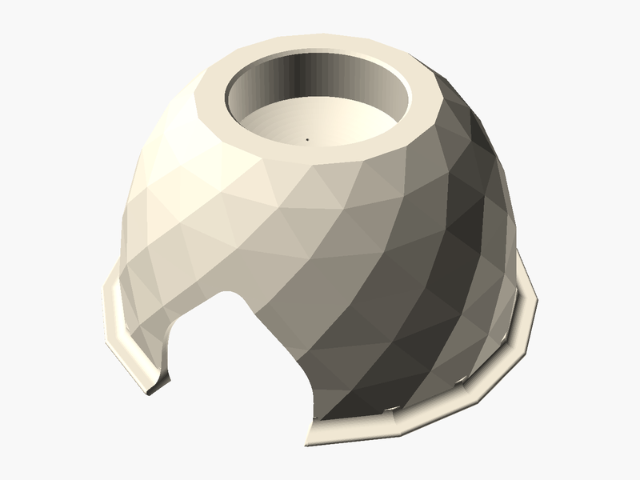

# Toad Abode

**Created by:** Willie

This is a toad house that sits on the ground in your garden. The cup on top catches rain and four tiny holes in the bottom of the cup let a little water drip slowly inside. The bottom of the house is open so the water keeps the dirt underneath damp and leaves a small puddle for the toad to drink. Toads need cool, dark and damp places to hide during the day, and the archway door lets them come and go. Toads are great garden helpers because they eat slugs and bugs that munch on your plants!

## Printed with PHA 🌱

**What is PHA?** PHA is a plastic made by tiny microbes! They munch on plant sugars and oils and store the PHA inside their bodies, kind of like how we store energy.

**Why is it eco-friendly?** It comes from plants instead of oil. And when it's all done, it can break down back into nature (in soil, and even in the ocean) instead of hanging around for hundreds of years.

**Printing tips:**
- 🧊 **Keep it cool:** set the nozzle to about 190–200 °C.
- 💨 **Lots of air:** turn the cooling fan up high and leave the printer doors or lid open.
- 🐢 **Go a little slower:** slower prints help each layer stick and cool nicely.
- ☀️ **Keep it dry:** store the spool in a bag with a desiccant pack so it doesn't soak up water.
